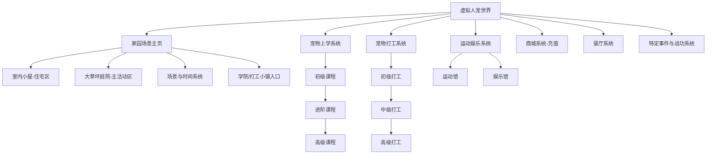
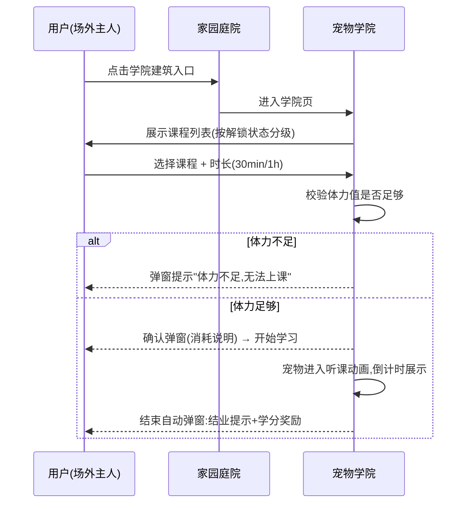

# 虚拟人宠世界模块 PRD

| 项目 | 内容 |
| --- | --- |
| 文档名称 | 虚拟人宠世界模块详细需求文档（PRD） |
| 产品线 | 宠物社区 App / 虚拟人宠世界 |
| 文档状态 | 待评审 |
| 版本号 | V1.0 |
| 作者 | 产品经理 |
| 评审人 | 待定 |

## 修订记录

| 版本 | 日期 | 修订人 | 修订说明 | 评审状态 |
| --- | --- | --- | --- | --- |
| V1.0 | 2026-10-17 | 产品经理 | 基于原《模块三 虚拟人宠世界 详细PRD》整理，补充字段定义、功能模块拆解与交互流程 | 待评审 |

---

## 一、背景与目标

### 1.1 需求背景

虚拟人宠世界是现实养宠的想象与延展：帮助自家宠物实现现实中无法完成的事（上学、打工、看电影、蹦极等）。设计上**不能与现实宠物属性相悖**，不能让虚拟宠物与现实宠物产生割裂感。

### 1.2 设计原则

- 家园场景内**只显示用户的虚拟宠物，不出现任何主人人物模型**；
- 用户 = 场外主人，全程通过屏幕点击、滑动、弹窗指令与宠物互动；
- 宠物拥有独立生命状态、多维属性、自主 AI 行为、全天候挂机生活；
- 宠物状态与 App 真实养宠部分数据**双向联动**。

### 1.3 核心目标

| 目标 | 衡量指标 |
| --- | --- |
| 提升用户留存与日活跃 | 模块次留 / 7 留、人均访问次数 |
| 建立虚拟币消费闭环 | A 币产出/消耗比、B 币付费渗透率 |
| 提升情感粘性 | 日均互动次数（抚摸/喂食/陪玩） |

### 1.4 四大核心体系

家园生活 → 宠物上学 → 宠物打工 → 宠物运动娱乐（+ 商城 / 餐厅 / 特定事件战功）。

---

## 二、功能架构

---

## 三、数据字段定义

### 3.1 宠物核心属性表（pet_attributes）

| 字段名 | 类型 | 范围 | 说明 | 变动规则 |
| --- | --- | --- | --- | --- |
| hunger | int | 0–100 | 饥饿值，需喂食恢复 | 随时间缓慢下降 |
| cleanliness | int | 0–100 | 清洁值，洗澡/梳毛恢复 | 随时间缓慢下降 |
| mood | int | 0–100 | 心情值，核心状态，决定动作活跃度 | 打工/上课下降，陪玩上升 |
| stamina | int | 0–100 | 体力值，上学/打工/运动消耗 | 消耗下降，休息恢复 |
| wisdom | int | 0–9999 | 智慧值，上课提升 | 课程结算增加 |
| growth | int | 0–9999 | 成长值，决定家园等级 | 全行为累积 |
| level | int | 1–100 | 家园等级 | 由成长值换算 |

> 所有属性**实时挂机变动、可视化数值展示**。

### 3.2 可选二元属性表（pet_personality）

| 属性对 | 高值行为表现 |
| --- | --- |
| 勇气值 / 胆小值 | 胆小：陌生人来访躲起来；勇气：独自外出追捕昆虫 |
| 冲动值 / 稳重值 | 冲动值且攻击值高：可能外出与其他狗打架 |
| 攻击值 / 包容值 | 攻击值高：可能触发战斗类任务 |
| 探索值 / 慵懒值 | 探索：家里行动轨迹密集；慵懒：可在院子里躺一天 |
| 黏人值 / 独立值 | 影响互动跟随行为 |
| 单纯值 / 心机值 | 影响剧情文案分支 |
| 安静值 / 活力值 | 影响待机动作频率 |
| 贪吃值 / 小胃值 | 影响喂食反馈与餐厅消费 |
| 戏精值 / 老实值 | 影响情绪气泡文案 |
| 秩序值 / 随性值 | 影响行为规律性 |
| 捣蛋值 / 乖巧值 | 捣蛋：拆家、啃墙皮、抓沙发、在主人床上尿尿 |
| 易惊值 / 钝感值 | 影响天气/事件反应 |

> 二元属性根据自家宠物特性选择，单个属性**世界排名靠前可触发特定剧情与特定战功**。

### 3.3 虚拟币字段

| 字段名 | 类型 | 说明 |
| --- | --- | --- |
| coin_a | int | A 币，打工生产的虚拟币 |
| coin_b | int | B 币，充值金币，10 元人民币 = 100 B 币 |

### 3.4 学业/职业状态字段

| 字段名 | 类型 | 说明 |
| --- | --- | --- |
| course_records | array | 课程记录：course_id、type（初级/进阶/高级）、duration（30min/1h）、status（进行中/已结业）、credit |
| job_records | array | 打工记录：job_id、job_level、start_time、end_time、reward_coin_a、reward_exp、reward_fragments |
| unlocked_jobs | array | 已解锁职业列表（由课程结业解锁） |
| medals | array | 战功勋章：medal_id、trigger_event、obtained_at |

---

## 四、功能模块与交互详述

### 4.1 主页面 —— 家园场景

**场景构成**：独栋小院全景，两大固定区域。

| 区域 | 定位 | 内容 |
| --- | --- | --- |
| 室内小屋（住宅区） | 休息区 | 睡觉、休息、回血、恢复心情；夜间自动进屋睡觉，白天自动进出；日常互动区域之一 |
| 大草坪庭院（主活动区） | 主活动区 | 自由散步、打滚、跑跳、待机闲逛；日常互动区域之一 |

**场景与时间系统**

| 子系统 | 规则 |
| --- | --- |
| 随机天气 | 晴天 / 阴天 / 小雨（雨天宠物会躲屋檐） |
| 昼夜 | 无昼夜实时同步 |
| 季节 | 春夏秋冬实时同步（秋天院子里有落叶） |

**菜单功能区分布**：庭院内置「学院入口」（上学系统）、「打工小镇入口」（打工系统）。

**交互**：
- 点击区域切换视角（室内 / 庭院），双指缩放查看全景；
- 庭院点击学院建筑 → 跳转上学系统；点击打工小镇 → 跳转打工系统；
- 页面顶部常驻属性面板（六个核心属性可视化），点击展开属性详情与二元属性雷达图。

### 4.2 基础家园生活系统（日常交互核心）

**① 宠物自主 AI 行为（挂机自动执行）**

庭院随机触发原生动作：
- 原地摇尾巴、踱步、趴草坪晒太阳；
- 低头嗅草地、小跑转圈、甩身体；
- 无聊时蹲坐发呆、望向屏幕（与用户对视）；
- 疲惫时自行回小屋睡觉休息；
- 浇花、清扫落叶；
- 多宠交互行为：打架、舔毛；
- 捣蛋值高：拆家、啃墙皮、抓沙发、在主人床上尿尿。

**② 用户手动交互操作（用户 = 场外主人）**

| 交互 | 操作方式 | 宠物反馈 |
| --- | --- | --- |
| 抚摸 | 点击宠物头部/背部 | 歪头、眯眼、摇尾巴、冒爱心特效 |
| 喂食 | 选择零食/主粮 | 低头进食、鼓嘴咀嚼动画 |
| 洗护 | 点击洗澡梳毛 | 乖乖站立、抖动身体、变干净闪光 |
| 陪玩 | 丢球、飞盘 | 跑动接住、带回用户视角 |

**③ 宠物情绪反馈体系**（完全复刻 Q 宠情绪表现）

| 情绪 | 触发条件 | 表现 |
| --- | --- | --- |
| 开心 | 心情值高/刚互动完 | 蹦跳、转圈、吐舌头、高频摇尾 |
| 平淡 | 正常状态 | 正常散步待机 |
| 委屈 | 饥饿/脏污 | 低头耷拉耳朵、慢动作、气泡吐槽文案 |
| 困倦 | 体力低 | 眼皮耷拉、走路缓慢、自动回屋趴睡 |

### 4.3 宠物上学系统

**入口**：家园庭院「宠物学院」建筑。

**学业体系（分级学习，课程随版本更新）**

| 层级 | 课程 |
| --- | --- |
| 初级课程 | 宠物行为习惯课、宠物基础体能课 |
| 进阶课程 | 厨艺课、宠物治愈陪伴课、宠物才艺课 |
| 高级课程 | 口才课、动物教育心理学、导盲搜救课 |

**学习机制**
1. 宠物根据自身品种和属性值**自动上学**，用户也可**手动安排**；
2. 可选择学习时长：30 分钟 / 1 小时；
3. 学习期间：宠物进入学院场景，坐立听课动画；
4. 收益：增加部分属性、解锁职业、提升家园等级；
5. 结束自动弹窗：结业提示 + 学分奖励。

**规则限制**
- 上学消耗饥饿值与少量体力，**体力不足无法上课**；
- 连续上课心情小幅下降，需用户课后陪玩恢复。

**交互流程**

### 4.4 宠物打工系统（唯一获取虚拟币的社区板块）

**入口**：家园庭院「打工小镇」。

**职业体系（分级解锁，随版本更新）**

| 层级 | 解锁条件 | 职业 |
| --- | --- | --- |
| 初级打工 | 上完初级课程 | 送外卖服务、猫咖狗咖被撸一天 |
| 中级打工 | 上完进阶课程 | 治愈陪伴师、甜品店烘焙师、宠物模特线下走秀、指定气味嗅闻 |
| 高级打工 | 上完高级课程 | 直播带货、猫狗学校讲师、导盲搜救 |

**打工机制**
- 自动打工（按品种与属性）或用户手动指派任务、选择打工时长；
- 打工期间宠物固定工作动画（站岗、乖巧坐立、才艺展示）；
- 消耗：体力、少量心情；
- 收益：**家园金币（A 币）**、经验值、专属装扮碎片。

**金币用途（闭环消费）**
- 购买基础家园装饰、庭院道具、宠物服装、宠物食品和日用品（非基础的需充值）；
- 解锁基础新场景、新互动动作（非基础的需充值）；
- 兑换积分。

### 4.5 宠物运动娱乐系统

宠物根据自身品种和属性值自动进入场馆，也可用户手动操作；消耗饥饿值和体力值，增强特定属性；**基础运动/娱乐消耗虚拟币（A 币），非基础需充值（B 币）**。

**运动馆**

| 序号 | 项目 |
| --- | --- |
| 1 | 宠物飞盘 |
| 2 | 宠物游泳 |
| 3 | 宠物健身房 |
| 4 | 宠物蹦极 |
| 5 | 宠物溜冰 |
| 6 | 宠物潜水 |

**娱乐馆**

| 序号 | 项目 |
| --- | --- |
| 1 | 宠物轰趴馆 |
| 2 | 宠物 KTV |
| 3 | 宠物游乐场 |
| 4 | 宠物电影院 |
| 5 | 宠物电玩城 |
| 6 | 宠物手作馆（随机刷新，给妈妈做拼豆带回家） |

**交互**：点击场馆 → 场馆列表页（展示消耗与属性加成）→ 确认进入 → 宠物进入场馆动画与倒计时 → 结束弹窗结算（属性提升提示）。

### 4.6 商城系统（充值系统）

| 子功能 | 说明 |
| --- | --- |
| 家园商城 | 充值购买各类非基础家具陈设、宠物用品（服装、食品、清洁用品、玩具） |
| 自由摆放 | 用户可自己摆放家具位置 |
| 货币体系 | A 币 = 打工产出；B 币 = 充值金币，10 元人民币 = 100 B 币 |

**交互**：商城入口 → 分类 Tab（家具/服装/食品/玩具/清洁）→ 商品详情（标注 A 币/B 币价）→ 购买 → 庭院摆放模式（拖拽放置、保存布局）。

### 4.7 餐厅系统（唯一只消耗虚拟币的社区板块）

- 花费一定虚拟币（A 币），宠物可选择自己喜欢的套餐吃饭；
- 随机给主人**打包小食**（可关联真实养宠模块福利）。

**交互**：餐厅入口 → 套餐列表（价格/口味标签，受贪吃值影响偏好）→ 下单 → 宠物进食动画 → 结算弹窗（随机打包小食展示）。

### 4.8 特定事件与特定战功系统（P0）

| 规则项 | 说明 |
| --- | --- |
| 触发方式 | 系统自动触发系列事件 |
| 属性联动 | 与宠物可选二元属性联动，属性值决定触发哪类事件与战功 |
| 触发模式 | 参考**旅行青蛙**：无任何交互、自动触发，弹窗文字 + 图片形式结算事件过程与奖励 |
| 奖励类型 | 战功勋章、虚拟币获取、属性值提升 |

**示例**：胆小值高 + 陌生人来访 → 「躲猫猫事件」；勇气值世界排名靠前 → 「捕虫勇士」勋章；冲动且攻击值高 → 「街头大战」事件（战斗任务）。

---

## 五、与真实养宠数据的双向联动

| 联动方向 | 说明 |
| --- | --- |
| 真实 → 虚拟 | 真实养宠记录（喂养、洗护、疫苗等）同步影响虚拟宠物初始属性与心情 |
| 虚拟 → 真实 | 虚拟事件奖励（餐厅打包小食、装扮碎片）回馈真实养宠模块权益 |

---

## 六、埋点设计

| 事件名 | 触发时机 | 关键参数 |
| --- | --- | --- |
| pet_world_page_show | 进入家园主页 | season、weather、pet_count |
| pet_touch_click | 抚摸互动 | interact_type、mood_before、mood_after |
| pet_feed_click | 喂食互动 | food_id、food_type（零食/主粮） |
| pet_bath_click | 洗护互动 | cleanliness_before |
| pet_play_click | 陪玩互动 | toy_type（球/飞盘） |
| school_course_start | 开始上课 | course_id、course_level、duration |
| school_course_finish | 结业 | course_id、credit、wisdom_delta |
| job_task_start | 开始打工 | job_id、job_level、duration |
| job_task_finish | 打工结算 | coin_a_reward、exp_reward、fragments_reward |
| sport_center_enter | 进入运动/娱乐场馆 | venue_id、venue_type（运动/娱乐）、pay_type（A币/B币） |
| mall_purchase | 商城购买 | goods_id、price、currency_type（A/B） |
| mall_furniture_move | 摆放家具 | furniture_id |
| restaurant_order | 餐厅下单 | set_meal_id、price_a、gift_snack |
| special_event_trigger | 特定事件触发 | event_id、related_attribute、rank |
| medal_obtain | 获得战功勋章 | medal_id |

---

## 七、非功能性需求与异常场景

| 场景 | 处理方案 |
| --- | --- |
| 断网/弱网 | 属性按本地最后同步时间离线结算，恢复联网后服务端校准 |
| 长时间未登录 | 挂机结算封顶（饥饿值不低于 0，心情值不低于 20），回归触发「主人回来了」欢迎动画 |
| 属性数值异常 | 服务端结算为准，客户端仅展示，防刷 |
| 多端登录 | 属性与金币以服务端为准，实时推送刷新 |

---

## 八、排期规划（建议）

| 里程碑 | 内容 |
| --- | --- |
| M1（P0） | 家园场景 + 四维核心属性 + 基础互动（抚摸/喂食/洗护/陪玩）+ 情绪反馈体系 + 特定事件与战功系统 |
| M2（P1） | 上学系统 + 打工系统 + A 币闭环 + 餐厅系统 |
| M3（P1） | 运动娱乐馆（首批场馆）+ 二元属性完整联动 |
| M4（P2） | 商城充值（B 币）+ 家具自由摆放 + 季节/天气完整版 + 课程与职业版本化更新机制 |

---

## 九、待确认问题

1. 二元属性是否允许后期重置/修改（影响属性养成付费点设计）；
2. 多宠家庭（多只虚拟宠物同院）的资源与交互上限；
3. A 币兑换积分的具体兑换比例与积分体系承接方；
4. 打包小食与真实养宠模块的权益打通方案需与运营确认。
